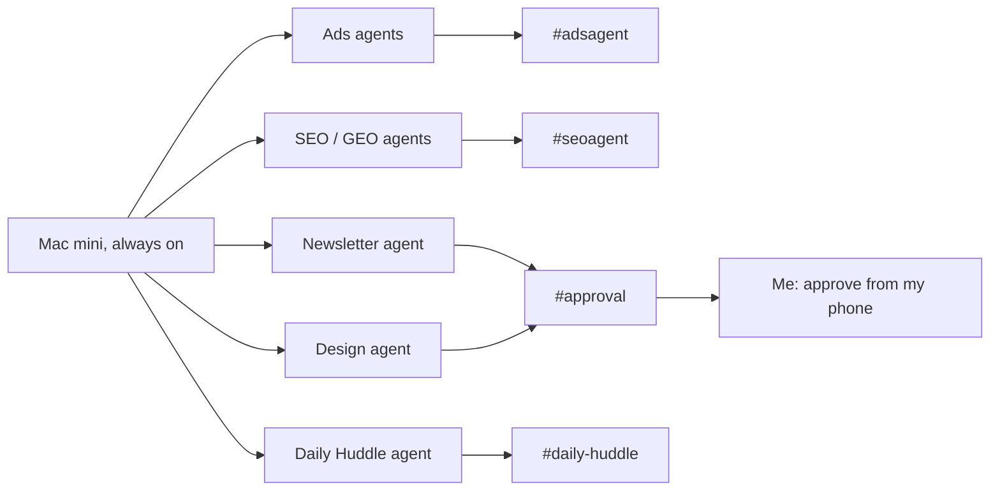

# The Night Shift

**A marketing department made of AI agents. They work while I sleep, and they report in the morning.**

> This page documents the design. The prompts, configs and scripts stay private.
>
> Related: [Agent governance](../governance/agent-rules.md) · [ADR-001](../decisions/ADR-001-switch-off-agents-that-cant-fix.md) · [Postmortem: false alerts](../postmortems/PM-003-false-alerts.md)

## The problem

I'm a one-person marketing department for five US brands. Paid search, SEO, five websites, weekly newsletters, design requests from sales, CRM hygiene, reporting to the CEO. The company had paused hiring a marketing assistant. I needed the output of an agency without the headcount.

## What I built

A team of AI agents, each owning one lane, running on a dedicated Mac mini that stays on 24/7.

## Design decisions

- **One owner per job.** Two agents doing the same task means double the noise and nobody accountable. Every job has exactly one agent.
- **Agents that can't fix things get switched off.** Early on, some agents only reported problems they couldn't solve or even confirm. They created more alarms than real issues. They're gone. Rule now: confirm before you report.
- **Drafts, never deliveries.** When a colleague asks for something, the agent does the work and sends it to `#approval`. Nothing reaches the requester without my yes.
- **Few channels, clear routing.** I cut the setup down to Ads, organic, approvals and one daily huddle. Every agent knows where it's allowed to post.
- **Cheap models where they're good enough.** The bar is "a bit better than a very good human at this job," not maximum intelligence. Most agents run on smaller models.
- **Hard limits on money.** Agents can optimize keywords and search terms all day. Budget changes always come to me.

## Stack

Claude · Claude Code · OpenClaw · Claw3D (viewer) · Slack · Tailscale (remote access) · Mac mini

## What I learned

People move with ambition. Agents need a clear beginning, middle and end. A good prompt gives them that. Most of my early failures were vague jobs, not weak models.

## Want to build one?

I teach this in **Build Your AI Marketing Team** and **OpenClaw and Claw3D**. → [prisel.dev](https://prisel.dev)
