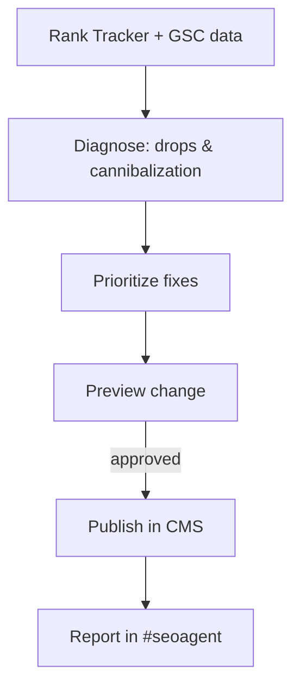

# SEO/GEO Operator

**A daily agent that keeps five websites healthy on Google and visible in AI search.**

> Case study only. The agent's prompt and scripts are not published.
>
> Related: [Postmortem: AI blog cannibalization](../postmortems/PM-001-ai-blog-cannibalization.md)

## The problem

One of our sites had been filled with AI blog posts nobody was checking. The same content got copied over and over, and dozens of pages started competing for the same keywords. That kind of cannibalization can make a ten-year-old business disappear from search. Five sites, no SEO team.

## What the agent does every day

1. Pulls live ranking data for the five brand sites
2. Flags keywords that dropped and pages that compete with each other
3. Ranks fixes by impact
4. Prepares on-page changes (titles, meta, internal links, consolidation) with a preview
5. Applies safe changes only after approval, then reports what it did

## Guardrails

- Never deletes a service page and never invents one
- Uses free data sources first; paid API calls only when they can't answer (our plan has a tight monthly unit budget)
- Confirms an issue on the live page before reporting it

## GEO (AI search)

I noticed the shift to AI search in my own habits before it showed in the data. The agent also tracks how often the brands get cited in AI answers, and we ran a community content plan to earn those mentions.

## Results (Ahrefs, Sept–Nov 2026)

- Brand A: top-10 keywords **23 → 65** in eight weeks
- Brand B: #1 keywords **38 → 84** in the same period

## Stack

Claude · Ahrefs MCP · Google Search Console · Vercel · Sanity · Webflow

## Learn it

Courses: **SEO and GEO with AI** and **GEO (ChatGPT, Claude, Perplexity)** → [prisel.dev](https://prisel.dev)
