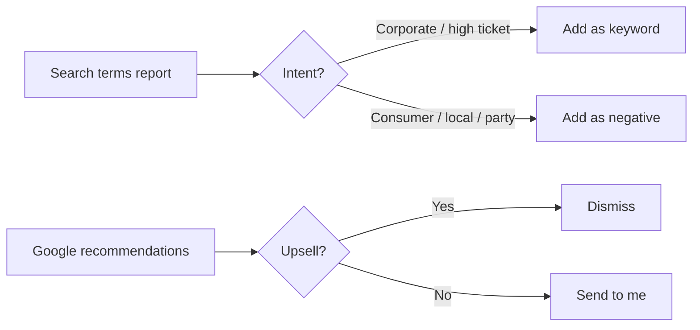

# Ads Optimizer

**A Google Ads agent that spends every cent on buyers, not browsers.**

> Design and logic only. No scripts or account data here.
>
> Related: [ADR-002 Agents never touch budget](../decisions/ADR-002-agents-never-touch-budget.md)

## The problem

When I started paid search for an events company, the ads were attracting the wrong people: birthday parties, bar mitzvahs, "near me" searches. The business ships nationwide to corporate clients. Every one of those clicks was wasted money.

## What the agent does

- Reviews search terms several times a day
- Adds negatives for low-ticket intent (parties, "near me", consumer searches)
- Adds positive keywords that bring corporate buyers
- Fixes campaigns that compete against each other
- Dismisses Google's upsell recommendations automatically
- Surfaces everything else to me, untouched

## The one rule it can't break

**It never touches budgets.** Budget changes follow a ramp plan set by leadership, and I make them myself.

## Why it worked

The rule I teach: don't pay for "near me" when you aren't a physical store. Combined with UTM tracking on every campaign, the cleanup shifted lead quality toward high-ticket corporate deals.

## Stack

Claude scheduled tasks · Google Ads · Slack

## Learn it

Course: **Google Ads with AI Agents** → [prisel.dev](https://prisel.dev)
