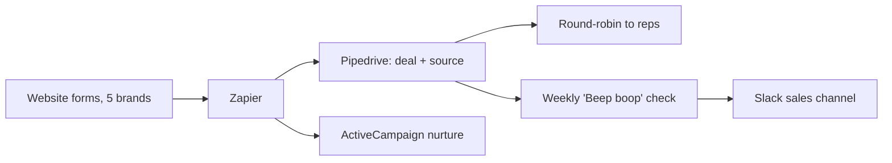

# RevOps Automations

**Lead routing, tracking and follow-up for five brands, built by a marketer.**

> Workflow maps only. Zaps and credentials stay private.
>
> Related: [Postmortem: the Zap that ate the quota](../postmortems/PM-002-runaway-zap.md)

## The problem

Leads came in from five sites and several ad campaigns, and nobody could say for sure where a deal came from. When the sales director left, deals were sitting in the first pipeline stage for days with no follow-up.

## What I built

**1. UTM tracking on everything.** Since May 2026, every campaign, email and link carries a consistent UTM scheme, so each lead arrives in the CRM with its source.

**2. Lead routing.** Form → CRM → round-robin between sales reps → email nurture sequence.

**3. The "Beep boop" reminder.** I had no authority over the sales team, so I built a bot that posts a weekly reminder in the sales channel listing deals with no follow-up. Leads stopped going cold.

## Design rules

- **Syncs run at most once a day.** A Zap once ran nonstop and burned the whole task quota. Never again.
- **A watchdog audits the Zaps** and alerts when one breaks.

## Stack

Zapier · Pipedrive · ActiveCampaign · Jotform · Slack

## Learn it

Courses: **Zapier Masterclass**, **CRM and RevOps with AI** and **AI Sales Ops** → [prisel.dev](https://prisel.dev)
